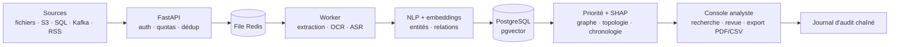

# Document Intelligence Platform (Mass Classification)

**Plateforme d'intelligence documentaire pour dossiers financiers et d'enquête : importer, extraire, classer, rechercher et explorer chaque pièce avec sa provenance.** Chaque lien entre entités renvoie à un passage source, chaque score est expliqué, et les analystes consignent leur revue dans un journal d'audit infalsifiable.

[](https://github.com/Matt95354855/document-intelligence-platform/actions/workflows/ci.yml)    

[English](README.md) · [Français](README.fr.md)

> Ce service est aussi intégré au monorepo [Harness](https://github.com/Matt95354855/llm-agent-harness), qui l'orchestre avec des LLM locaux.

## Points forts

- **Chaîne complète** : import dédupliqué par SHA-256 → texte / OCR / transcription audio-vidéo → embeddings multilingues 384 d dans pgvector → entités, montants et relations NLP → priorité expliquée → revue humaine.
- **Explicable, pas une boîte noire** : contributions des règles et SHAP exact sur la priorité par règles ; un réseau de neurones topologique (couches simpliciales + attention multi-tête, PyTorch) qui ne prédit qu'avec un checkpoint approuvé — aucun score n'est présenté comme une probabilité de fraude.
- **Analyse de graphe et du temps** : graphe de relations sourcées, homologie persistante bornée (caractéristiques topologiques), chronologie qui distingue dates déclarées par la source et dates d'import.
- **Socle de production** : worker asynchrone avec baux et reprises, clés API multi-espaces et rôles `admin` / `analyst` / `reader`, limitation de débit Redis, journal d'audit chaîné par SHA-256, métriques Prometheus, Compose et manifestes Kubernetes avec option CUDA.
- **Connecteurs** : fichiers, RSS, S3, SQL, MongoDB, SFTP, Kafka.
- **Benchmark LLM sur DocLayNet** (via Harness) : GPT-OSS 20B atteint **82,8 % d'accuracy / 66,9 % de Macro-F1** contre 78,8 % / 56,5 % pour Qwen 3.6 27B sur 203 objets de mise en page, entièrement en local sur un GPU de 4 Go.

## Architecture



## Démarrage rapide

Mode découverte — sans Docker, compte ni téléchargement de modèle, trois pièces fictives :

```bash
git clone https://github.com/Matt95354855/document-intelligence-platform.git
cd document-intelligence-platform
python -m venv .venv && source .venv/bin/activate
pip install -r requirements-demo.txt
python -m mass_classification.demo          # http://127.0.0.1:8000
```

Rechercher ensuite `virement Nova`, ouvrir les vues **Relations** et **Chronologie**, puis enregistrer une revue. Le service complet (PostgreSQL, Redis, worker, modèles) se lance avec `docker compose` — voir le [guide détaillé](docs/GUIDE.fr.md).

## Structure du dépôt

```text
mass_classification/   API, worker, extraction, embeddings, entités, TNN, SHAP, topologie, connecteurs
mass_classification/static/  console analyste (PWA responsive)
tests/                 démo, provenance des dates, suggestions d'entités, règles, invariants d'audit
deploy/k8s/            manifestes Kubernetes de référence (dont worker GPU)
docs/                  guide technique, guide de conception de la plateforme
```

## Limites

Le classifieur neuronal nécessite des données annotées et un checkpoint approuvé avant toute prédiction ; la validation de bout en bout en charge de production exige une infrastructure représentative. Avant tout usage sensible : jeux d'évaluation annotés, tests de droits entre espaces, TLS, secrets et politique de conservation. Voir le [guide technique](docs/README_TECHNIQUE.md).

## Documentation

[Guide détaillé](docs/GUIDE.fr.md) · [Guide technique](docs/README_TECHNIQUE.md) · [Conception de la plateforme](docs/GUIDE_CONSTRUCTION_PLATEFORME_COMPLETE.md) · [Benchmark DocLayNet](https://github.com/Matt95354855/llm-agent-harness/blob/main/docs/doclaynet-benchmark-2026-10-01.md)

## Licence

Voir [LICENSE](LICENSE). Ne jamais publier de données bancaires, personnelles ou de dossiers réels.
