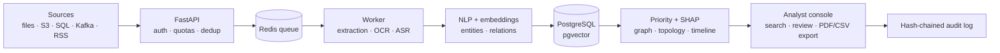

# Mass Classification

**Document intelligence platform for financial and investigative case files: ingest, extract, classify, search and explore every document with its provenance.** Every entity link points back to a source passage, every score is explained, and analysts record their review in a tamper-evident audit log.

[](https://github.com/Matt95354855/Mass_Classification/actions/workflows/ci.yml)    

[English](README.md) · [Français](README.fr.md)

> This service is also integrated into the [Harness](https://github.com/Matt95354855/Harness) monorepo, which orchestrates it with local LLMs.

## Highlights

- **End-to-end pipeline**: SHA-256 deduplicated ingestion → text / OCR / audio-video transcription → 384-d multilingual embeddings in pgvector → NLP entities, amounts and relations → explained priority → human review.
- **Explainability, not black boxes**: rule contributions and exact SHAP on the rule-based priority; a topological neural network (simplicial layers + multi-head attention, PyTorch) that only predicts with an approved checkpoint — no score is presented as a fraud probability.
- **Graph and time analysis**: source-backed relation graph, bounded persistent homology (topological features), timeline separating source-declared dates from import dates.
- **Production foundations**: async worker with leases and retries, multi-tenant API keys with `admin` / `analyst` / `reader` roles, Redis rate limiting, SHA-256 hash-chained audit log, Prometheus metrics, Compose and Kubernetes manifests with a CUDA option.
- **Connectors**: files, RSS, S3, SQL, MongoDB, SFTP, Kafka.
- **LLM benchmark on DocLayNet** (via Harness): GPT-OSS 20B reached **82.8 % accuracy / 66.9 % macro-F1** vs Qwen 3.6 27B at 78.8 % / 56.5 % on 203 layout objects, fully local on a 4 GB GPU.

## Architecture



## Quick start

Discovery mode — no Docker, account or model download, three fictional documents:

```bash
git clone https://github.com/Matt95354855/Mass_Classification.git
cd Mass_Classification
python -m venv .venv && source .venv/bin/activate
pip install -r requirements-demo.txt
python -m mass_classification.demo          # http://127.0.0.1:8000
```

Then search `virement Nova`, open the **Relations** and **Timeline** views, and record a review. The full service (PostgreSQL, Redis, worker, models) runs with `docker compose` — see the [detailed guide](docs/GUIDE.fr.md).

## Repository structure

```text
mass_classification/   API, worker, extraction, embeddings, entities, TNN, SHAP, topology, connectors
mass_classification/static/  analyst console (responsive PWA)
tests/                 demo, date provenance, entity suggestions, rules, audit invariants
deploy/k8s/            reference Kubernetes manifests (incl. GPU worker)
docs/                  technical guide, platform design guide
```

## Limitations

The neural classifier needs annotated data and an approved checkpoint before it predicts anything; end-to-end validation at production load requires representative infrastructure. Before any sensitive use: annotated evaluation sets, cross-tenant permission tests, TLS, secrets and retention policies. See the [technical guide](docs/README_TECHNIQUE.md).

## Documentation

[Detailed guide (FR)](docs/GUIDE.fr.md) · [Technical guide (FR)](docs/README_TECHNIQUE.md) · [Platform design (FR)](docs/GUIDE_CONSTRUCTION_PLATEFORME_COMPLETE.md) · [DocLayNet benchmark](https://github.com/Matt95354855/Harness/blob/main/docs/doclaynet-benchmark-2026-10-01.md)

## License

See [LICENSE](LICENSE). Never commit real banking data, personal data or case material.
